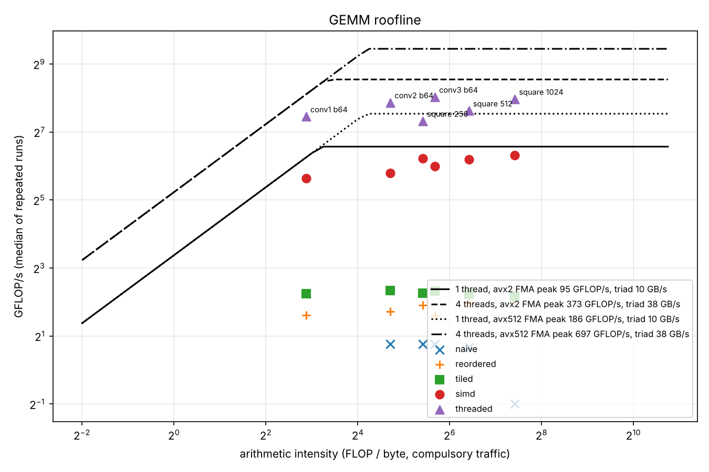

# tinyinfer

A CNN inference engine in C++, from scratch. A small image classifier is
trained in PyTorch, exported to a flat binary format, and run by C++ code
written for exactly that model: conv2d (as im2col + GEMM), ReLU, max-pool,
flatten, linear. The matrix multiply is then taken from a naive triple loop to
a packed, register-blocked SIMD kernel on all cores, and an INT8 path is
compared against FP32. Every speedup is a measurement, not a claim.

## Results

Measured on a 4-vCPU Intel Xeon @ 2.10 GHz cloud VM (AVX2 / AVX-512 / VNNI),
GCC 13.3, `-O2 -march=native -fopenmp`. Every number is a median of repeated
runs; the file in the last column has the method and the raw data.

| | Result | Where |
|---|---|---|
| Model | TinyCNN, 3 x conv3x3 + linear, 113,738 parameters, CIFAR-10 | `results/model.md` |
| FP32 accuracy (PyTorch, 10,000 test images) | 83.71% | `results/model.md` |
| C++ engine vs PyTorch | max abs logit error 2.5e-05 (naive GEMM), 9.5e-06 (SIMD GEMM); 10,000 / 10,000 identical predictions | `results/parity.md` |
| GEMM, naive to final (1024 x 1024 x 1024) | 0.50 to 250 GFLOP/s on 4 threads (500x); 79 GFLOP/s on 1 thread = 84% of the measured AVX2 FMA roofline | `results/gemm.md` |
| GEMM on the network's own shapes | conv3 at batch 64: 1.70 to 261 GFLOP/s, 70% of the 4-thread AVX2 roofline | `results/gemm.md` |
| Inference, naive to final FP32 | 11.6 to 0.142 ms per image at batch 64 (82x), 7,000 images / s | `results/gemm.md`, `results/int8.md` |
| INT8 vs FP32 | 1.3x faster with 64 images hot in cache, 1.5x on a 10,000-image stream (0.106 and 0.097 ms per image); GEMMs 2.2 to 2.6x faster; weights 3.92x smaller; accuracy 83.73% vs 83.71% on 10,000 images | `results/int8.md` |
| Profiling | stage timers + gprof + callgrind; the first INT8 version was 1.07x faster, the profile named the scalar packing (41%) and the elementwise passes; seven fixes took INT8 to 2.5x and FP32 to 1.7x their first versions | `results/int8.md` |
| Apple Silicon preview (GitHub M1 runner, 3 virtual cores) | NEON `fmla` and `sdot` kernels: FP32 0.253 and INT8 0.138 ms per image (1.8x); INT8 results bit-identical to x86 | `results/apple-m1-runner/` |



The roofline: measured FMA peaks (AVX2, the ISA the kernel is written in, and
AVX-512, which the chip also has) against measured triad bandwidth. The five
GEMM versions are plotted on the six benchmark shapes. All but conv1 are
compute-bound; conv1 (K = 27) sits left of the four-thread ridge and is
memory-bound there.

Every milestone ends in a results file written by the code that produced the
numbers, not by hand: `results/model.md` (M1), `results/parity.md` (M2),
`results/gemm.md` plus the CSVs and chart (M3), `results/int8.md` and the
profiler outputs (M4).

## Layout

```
python/      train.py, export.py: PyTorch side. cifar10.py: dataset. roofline.py: chart.
include/     public headers (tensor, loader, layers, gemm, gemm_int8, quant, model, model_int8)
src/         the engine. src/gemm/: the five float GEMMs. src/quant/: INT8 GEMM and quantisation.
bench/       bench_gemm, bench_peak, bench_bandwidth, bench_infer
tests/       one executable per area, registered with CTest; test_parity and test_quant use data/export
tools/       the `tinyinfer` command line (parity, quantize)
data/export/ FP32 and INT8 weights, 1,000 test images, PyTorch's logits, calibration images (5 MB)
results/     model.md, parity.md, gemm.md, int8.md, the CSVs, profiler outputs, roofline chart
docs/        format.md, the binary container spec
```

## Build and run

```sh
cmake -S . -B build -G Ninja          # -DTINYINFER_SANITIZE=ON for ASan+UBSan
cmake --build build
ctest --test-dir build --output-on-failure

build/tinyinfer parity --weights data/export/weights.bin --images data/export/test_images.bin \
                       --logits data/export/ref_logits.bin --profile
build/tinyinfer quantize --weights data/export/weights.bin --calib data/export/calib_images.bin \
                         --out build/weights_int8.bin
build/tinyinfer parity --int8 build/weights_int8.bin --images data/export/test_images.bin \
                       --logits data/export/ref_logits.bin
build/bench_gemm --csv results/gemm.csv
```

Builds with `-O2 -Wall -Wextra -Wpedantic -Wshadow -Werror -march=native`.
The SIMD kernels are chosen at compile time from the host CPU: AVX2 (+VNNI)
on x86-64, NEON (+dotprod) on AArch64, plain C++ elsewhere. On macOS,
`brew install libomp` and pass `-DOpenMP_ROOT=$(brew --prefix libomp)` for the
threaded GEMM. Without OpenMP the threaded kind silently runs single-threaded.

To retrain and re-export (needs PyTorch, see `python/requirements.txt`):

```sh
python python/train.py      # downloads CIFAR-10, ~5 min on 4 cores, writes results/model.md
python python/export.py     # writes data/export/*
```

## Design decisions

**One model, specialised code.** The engine runs TinyCNN and nothing else.
There is no graph, no operator registry, no generic shape machinery. That
keeps every function short enough to reason about and benchmark on its own.

**NHWC activations.** PyTorch is NCHW; the engine converts once during
preprocessing. With channels innermost, im2col copies whole channel runs with
`memcpy` instead of gathering single floats, and the convolution becomes
`col[batch*pixels][k*k*cin] x w[k*k*cin][cout]` whose output is already NHWC.
The cost is a one-time re-packing of the exported weights (and a row
permutation of the linear layer, because PyTorch flattens in CHW order).

**im2col + GEMM, not a direct convolution.** A direct 3x3 convolution does the
same multiply-adds but with seven nested loops and awkward access patterns.
im2col pays memory (the column matrix is k*k = 9x the input) to turn the
problem into one dense GEMM, which is the operation worth optimising deeply.
The direct version is kept as the test oracle.

**The binary format is self-describing and the loader distrusts it.** Every
file is a list of named, typed, shaped tensors (`docs/format.md`). The reader
bounds-checks every field before using it and throws on anything malformed:
truncated files, dims that overflow, names with odd bytes, duplicates,
trailing bytes. The loader tests feed it each of those.

**Weights stay in PyTorch layout on disk.** Any layout the engine prefers is
produced at load time, so the export is a dump of the state dict and the
parity test compares like with like.

**The GEMM ladder is five functions behind one signature.** Each version is
tested against the naive one on awkward sizes before it is timed, and the
end-to-end parity test runs with every version. See `results/gemm.md` for what
each step bought and why.

**INT8 is symmetric, per-channel for weights, per-tensor static for
activations.** Output channels of a conv differ in magnitude by an order of
magnitude; one weight scale for all of them would waste most of the 8 bits on
the small channels. Activation scales come from the largest value each layer
saw on 500 training images. Products accumulate in int32 and are dequantised
to float right after the GEMM, so ReLU, pooling and the layer hand-off stay
in float. See `results/int8.md`.

**im2col writes the GEMM's packed layout.** The SIMD kernels want A in strips
of 6 (AVX2) or 8 (NEON) rows per 256-deep block. Rather than have im2col write
a row-major matrix and the GEMM copy it into strips, im2col scatters straight
into the strips (`im2col_nhwc_packed`, `gemm_packed_a`), which removed a pass
worth 21% of FP32 time. The layout is documented in `include/tinyinfer/gemm.h`
and tested against an independent implementation of the formula.

**Scratch buffers are reused and never zero-filled on regrowth.** The model,
both GEMMs and im2col keep their work buffers between calls, so steady-state
inference does not allocate; a default-initialising allocator keeps
`resize()` from memsetting the regrown part (7% of instructions before).

## Reproducing the numbers

Every table in `results/` names the CPU, compiler and flags it was produced
with, and every benchmark reports the median of repeated runs after a
warm-up. To reproduce on another machine:

```sh
build/bench_peak --csv results/peak.csv
build/bench_bandwidth --csv results/bandwidth.csv
build/bench_gemm --csv results/gemm.csv
build/bench_infer --int8 build/weights_int8.bin --csv results/infer.csv
python python/roofline.py            # results/roofline.png + the markdown table
```

## What did not work

The full lists are in `results/gemm.md` and `results/int8.md`. The ones worth
knowing before the next project:

- **The peak benchmark had to be fixed twice before it bounded anything.**
  16 accumulators on an ISA with 16 registers spilled; 12 accumulators in an
  array that GCC did not unroll lived on the stack. Both versions reported a
  "peak" below the GEMM kernel's actual speed. A ceiling is a program too.
- **Loop reordering made the smallest layer slower**, and **cache tiling
  bought under 20% with GCC** because the scalar inner loop was bound by the
  store port, not by misses. The same source with Clang auto-vectorised and
  tiling then showed its purpose. The explicit micro-kernel is the only step
  whose speed does not depend on the compiler.
- **The first INT8 engine was 1.07x faster than FP32** despite a 4x wider
  dot product: packing A one byte at a time cost 1.6x the kernel it fed, and
  ReLU, bias, zero-filled scratch and im2col together cost more than the
  GEMM. Each fix came from a specific line in a profile.
- **callgrind ran the native binary for 2.6 million instructions and
  stopped**: valgrind has no AVX-512, and it did not say so. The profile had
  to come from a Haswell build.
- **gprof put 40% of INT8 time in a function that returns a string**; it
  was the OpenMP outlined body next to it in the object file.
- **Threads at batch 1 cost more than they gave** until single-block layers
  skipped the parallel region.
- **The first packed INT8 im2col made INT8 slower than no fusion** (0.107 to
  0.180 ms): a byte-wise scatter with a divide per byte. The same 32-bit
  group copy that had fixed the INT8 packing fixed it again.

## Reproducing on your own machine

One command builds, tests and benchmarks, and writes everything into
`results/<cpu-name>/`: machine description, the four benchmark CSVs, per-stage
profiles for both engines, perf profiles when perf is available, and the
roofline chart.

```sh
tools/run_benchmarks.sh --quick    # about 2 minutes: checks the toolchain, numbers not for use
tools/run_benchmarks.sh            # the real run, about 10 minutes
```

**On Windows, use WSL2.** The code uses GCC/Clang builtins and OpenMP, so it
builds in WSL2's Ubuntu, not with MSVC. In PowerShell, `wsl --install -d
Ubuntu-24.04`, then in the Ubuntu shell:

```sh
sudo apt update
sudo apt install -y build-essential cmake ninja-build git python3-numpy python3-matplotlib linux-tools-generic
git clone https://github.com/yougijain/oigeswhlijs && cd oigeswhlijs
tools/run_benchmarks.sh --quick && tools/run_benchmarks.sh
```

Clone inside the Linux filesystem (`~/`), not under `/mnt/c`, which is much
slower. WSL2 runs on the real cores with only a thin hypervisor layer, so the
kernels run at native speed, but three things decide whether the numbers are
worth keeping:

- **Power.** Plug the laptop in, set Windows to its best-performance power mode,
  and close other programs. On battery, clocks drop and medians drift.
- **Hybrid cores.** On Intel 12th-generation and later, OpenMP threads can land
  on E-cores. Set `OMP_NUM_THREADS` to the P-core count (Task Manager, or `lscpu`)
  before the run, and say so with the numbers.
- **Profiling.** WSL2 has no `perf` package for its kernel, but the binary from
  `linux-tools-generic` works, and the script finds it. WSL2 does not expose
  hardware counters, so the script falls back to timer sampling (`cpu-clock`),
  which gives correct per-function profiles but no cache-miss counts. Unlike
  gprof, perf attributes OpenMP-outlined functions correctly.

Which kernels you get depends on the CPU, and the script records it in
`backends.txt`. Intel client CPUs since Alder Lake have AVX2 and AVX-VNNI but no
AVX-512; recent AMD Ryzen has AVX-512 and VNNI. Either way the FP32 path is the
AVX2 6x16 kernel and INT8 uses VNNI when present.

**ARM.** The NEON kernels (8x12 `fmla` by element for FP32, 8x12 `sdot` for
INT8) pass every test cross-compiled under `qemu-aarch64` and natively on a
GitHub macOS runner. A preview from a virtual M1 is in
`results/apple-m1-runner/`: INT8 is 1.8x FP32 there, but that machine's peak
measurement reads below the kernel, so its roofline is broken. For real ARM
numbers, the same script runs unchanged on an AWS Graviton instance
(`c7g.xlarge`, Ubuntu 24.04, about an hour). Graviton has the hardware counters
WSL2 lacks.

## Where to look for the usual questions

`docs/whiteboard.md` is the short version: each kernel as you would write it
on a whiteboard, the numbers that go with it, and a self-check list.

- Why convolution becomes a matrix multiply and what im2col costs:
  `include/tinyinfer/layers.h`, "im2col + GEMM" above, and the conv1 row of
  the roofline (K = 27 makes it memory-bound).
- Why loop order changes speed when the math is identical:
  `results/gemm.md`, steps 1 and 2, including the case where it got slower.
- What tiling does to cache misses and how the tile size was picked:
  `results/gemm.md`, step 3 and the sweep table.
- What SIMD buys and why it is not a flat width-times speedup:
  `src/gemm/gemm_kernel.h` and `results/gemm.md`, step 4.
- Memory-bound or compute-bound: `results/gemm.md`, the roofline section.
- Why INT8 is faster, where accuracy goes, why per-channel scales:
  `include/tinyinfer/quant.h`, `src/quant/gemm_int8_kernel.h`, `results/int8.md`.
- What the profiler showed that was surprising: `results/int8.md`, the
  "before" tables and the six fixes.

## CI

`.github/workflows/ci.yml` builds and tests on every push with GCC and Clang
on Linux (x86-64, with OpenMP), under AddressSanitizer + UBSan, and with
Apple Clang on a macOS arm64 runner so the NEON kernels are tested on real
hardware. Actions are pinned to commit hashes and Dependabot keeps them
current. The benchmarks are built and smoke-run in CI but their numbers are
not recorded there: a shared runner is not a benchmark machine. A separate
manual workflow (`bench-macos.yml`, run from the Actions tab) runs the full
suite on the macOS runner and uploads the CSVs as an artifact.

## License

MIT, see `LICENSE`.
